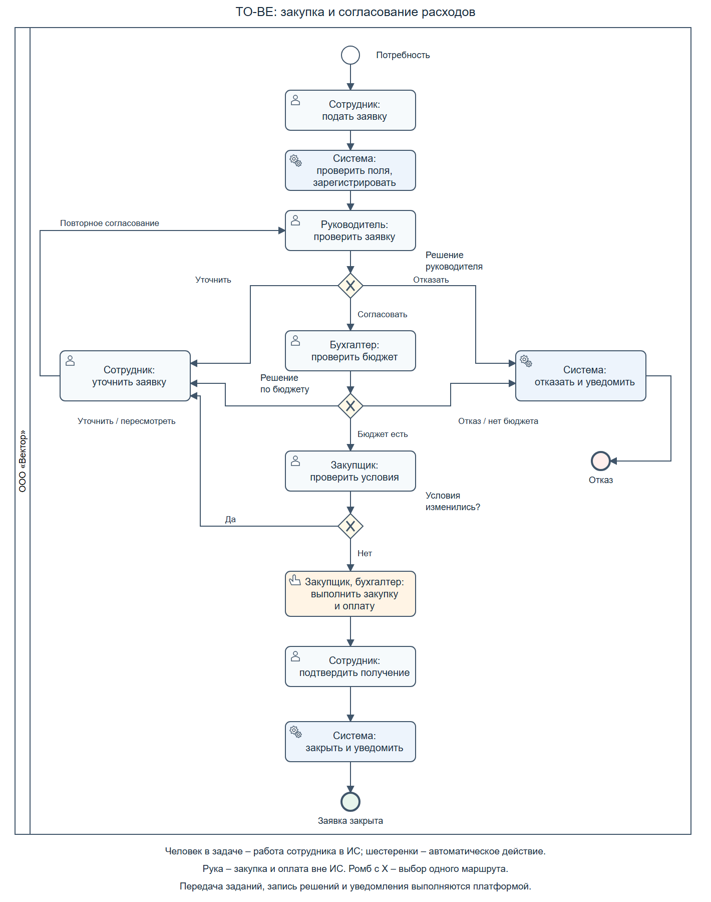

# Концепция информационной системы
 
**Практическая работа № 2:** «Разработка концепции информационной системы»  
**Тема проекта:** «Разработка концепции информационной системы управления заявками на закупку и согласованием расходов в небольшой организации»

**Выполнил:** Шитарев Андрей Сергеевич 

**Группа:** K3340

**Преподаватель:** Духанов Алексей Валентинович

**Поток:** ПроектИнфСист 1.2

## Введение

Цель работы - обосновать выбор концепции информационной системы управления заявками на закупку и согласованием расходов в небольшой организации.

Для достижения цели необходимо уточнить объект автоматизации и требования пользователя, изучить аналоги, разработать не менее трех альтернативных вариантов, оценить нужные средства и выбрать подходящий вариант. Далее необходимо описать будущий процесс (TO-BE), оценить эффекты и экономическую целесообразность, выявить риски, определить условия приемки и подготовить план внедрения.

## 1. Характеристика объекта автоматизации и требования пользователя

ООО «Вектор» разрабатывает и сопровождает программы: **80 сотрудников, 5 подразделений, 100 заявок на закупку в месяц, 40 пользователей будущей системы**. Заявки передаются по почте и в мессенджерах, расходы записываются в Excel.

Данные об организации, требования, оценки затрат, результатов и рисков – **учебные допущения**. Реального обследования не было. Цены программ приведены по источникам.

**Участники.** Сотрудник подает заявку и подтверждает получение. Руководитель проверяет необходимость покупки. Бухгалтер проверяет средства и оплачивает. Закупщик работает с поставщиком и закрывает заявку. Поставщик передает товар или оказывает услугу.

### Текущий процесс (AS-IS)

AS-IS – описание того, как работа выполняется сейчас.

1. Сотрудник определяет потребность и срок покупки.
2. Пишет руководителю предмет, количество, обоснование, сумму и срок. Общего шаблона нет.
3. Руководитель одобряет, возвращает для уточнения или отказывает с объяснением причины.
4. Бухгалтер проверяет бюджет в Excel. При нехватке денег заявку пересматривают или отклоняют, уведомив сотрудника.
5. Закупщик получает согласованную заявку, записывает ее в Excel и уточняет недостающие данные.
6. Закупщик заказывает, бухгалтер оплачивает. Изменения суммы или предмета требуют повторного согласования до заказа.
7. Сотрудник подтверждает получение, закупщик отмечает завершение в Excel. Документы остаются в файлах и переписке.

**Проблемы, их причины и последствия:**

- Разные каналы подачи – заявки теряются или дублируются.
- Нет шаблона – приходится уточнять сведения.
- Ручная передача и напоминания – закупки задерживаются.
- Не виден ответственный и этап – возникают повторные запросы.
- Разные файлы бюджета – возможны неверно согласованные расходы.
- Повторный ввод – ошибки и лишнее время.
- Документы хранятся отдельно – долго искать решения и составлять месячный отчет.

**Исходные показатели:** обработка заявки – **60 человеко-минут** активного времени всех участников; месячный отчет – **4 человеко-часа** отдельно; согласование – **3 рабочих дня** от подачи до решения; возвраты – **25% заявок** хотя бы с одним уточнением. Проверка – учет времени и переписка. Возвраты включены в 60 минут, ожидание, выбор поставщика и поставка исключены. Повторная отправка не считается новой заявкой.

### Требования

Функциональные требования – нужные действия. **Must** означает обязательное требование: не выполняющий его вариант исключается. Для варианта А допустимо ручное выполнение.

- **Ф1, Must:** форма и общий список (реестр): номер, автор, подразделение, предмет, сумма, срок. Это уменьшает потери.
- **Ф2, Must:** решения двух согласующих, причины отказа, возврат и повторное согласование изменений. Это сохраняет историю.
- **Ф3, Must:** проверка средств с учетом согласованных сумм до закупки. Это снижает ошибки бюджета.
- **Ф4, Must:** ответственный, состояние, получение и закрытие. Это сокращает повторные запросы.
- **Ф5, желательно:** автоматическая передача и напоминания против задержек.
- **Ф6, желательно:** история, поиск и отчет без повторного ввода.

Нефункциональные требования – условия работы:

- **Н1, Must:** сотрудник видит свои заявки, руководитель – своего подразделения, бухгалтер и закупщик – нужные им.
- **Н2, Must:** ежедневная копия или выгрузка заявок и решений.
- **Н3, желательно:** русский интерфейс в браузере без установки программы.
- **Н4, желательно:** 40 пользователей, 10 одновременно; не менее 95% операций – до 3 с.

Ограничения Must: **О1** – запуск до **650 000 руб.**; **О2** – до **12 недель**; **О3** – 40 пользователей без замены бухгалтерской и банковской систем. Хранение, обработка и возврат облачных данных определяются договором. Избыточные персональные данные не собираются.

## 2. Аналитический обзор аналогов и готовых решений

Сравним готовые программы по возможностям, оплате, обмену и размещению. Данные с официальных сайтов на 09.11.2026, без настройки.

| Решение | Возможности | Оплата | Обмен и размещение |
|---|---|---|---|
| Pyrus | Формы, согласование, список заявок, отчеты; шаблон проверки бюджета [2], [3], [4]. | Облако: 4 980 руб. за пользователя в год или 500 руб./мес. Для 40 сотрудников: 40 × 4 980 = 199 200 руб./год. Серверная версия: 990 000 руб./год за 100 пользователей [2]. | Выгрузка и программный обмен [4], [5]. Облако или свой сервер [2]. |
| Битрикс24 | Задания, согласование и напоминания [7]. | «Профессиональный», до 100 пользователей: 13 990 руб./мес.; при годовой оплате – 11 190 × 12 = 134 280 руб./год [8]. | Программный обмен и приложения [9]. Облако или установка на своем сервере [10]. Дополнительные подписки оплачиваются отдельно [8]. |
| ELMA365 Standard | Формы, приложения и настройка порядка работы [11]. | От 20 именных лицензий. Облако: 14 000 руб. за пользователя в год; для 40 – 40 × 14 000 = 560 000 руб./год. Свой сервер: 17 000 руб. за пользователя единовременно [12]. | Программный обмен [13]. Облако или свой сервер [12]. |

Битрикс24 дешевле, ELMA365 дороже и подходит для нескольких процессов. Для Б принят Pyrus: формы и согласование подходят задаче. Это оценка по описаниям. Хранение и поддержка уточняются в договоре.

## 3. Альтернативные варианты концепции ИС

Сравним улучшение текущего порядка, готовую программу и свою разработку. Ставка проектных работ – **1 000 руб./ч**. Человеко-месяц – работа одного человека за месяц, здесь **160 ч**. Почта и Excel уже имеются.

**А – единые правила и Excel.** Шаблон, общий список, папки с правами и копиями; согласование вручную. Аналитик – 24 ч, обучение и проверка – 16 ч: всего 40 ч (0,25 чел.-мес.). Запуск: 40 × 1 000 = **40 000 руб., 2 недели**. Поддержка: 24 × 1 000 = **24 000 руб./год**. Дешево, но остаются ручная работа и ошибки файлов.

**Б – Pyrus.** Через браузер работают форма, задания, напоминания, история и отчеты; бюджет проверяет бухгалтер. Аналитик – 40 ч, настройщик – 80 ч, проверка – 24 ч, обучение – 16 ч: 160 ч (1 чел.-мес.). Запуск: 160 × 1 000 = **160 000 руб., 6 недель**. В год: подписка 199 200 [2] + поддержка 48 × 1 000 = **247 200 руб.** Готовые функции ускоряют запуск, но нужны подписка и интернет.

**В – свое приложение.** Те же действия со своими правилами и лимитами: Django, PostgreSQL и один сервер. Аналитик – 80 ч, разработчик – 400 ч, проверка – 80 ч, запуск и обучение – 40 ч: 600 ч (3,75 чел.-мес.). Запуск: 600 × 1 000 = **600 000 руб., 12 недель**. В год: поддержка 72 × 1 000 + сервер и копии 48 000 = **120 000 руб.** Больше свободы, но дольше разработка и нужна своя поддержка.

Общие расходы за три года (**TCO**, в методичке – совокупная стоимость владения) включают запуск и три года работы:

- А: 40 000 + 3 × 24 000 = **112 000 руб.**
- Б: 160 000 + 3 × 247 200 = **901 600 руб.**
- В: 600 000 + 3 × 120 000 = **960 000 руб.**

Это формула (2) раздела 6. Цены постоянны, дополнительные налоги не учитываются. Обычная работа с заявками в поддержку не входит.

## 4. Сравнение вариантов и обоснование выбора

Проверим требования раздела 1, затем сравним затраты и возможности. В таблице – ожидаемое выполнение, без испытаний.

| Требование | А | Б | В |
|---|---|---|---|
| Ф1–Ф4: заявка, решения, бюджет, закрытие; Must | Да, вручную | Да, бюджет проверяет бухгалтер | Да |
| Ф5: автоматическая передача | Нет | Да | Да |
| Ф6: история и отчет без повторного ввода | Частично | Да | Да |
| Н1–Н2: доступ и копии; Must | Да | Да | Да |
| Н3: браузер | Частично | Да | Да |
| Н4: число пользователей и скорость | Частично | Да, проверить | Да, проверить |
| О1–О3: бюджет, срок, число пользователей; Must | Да | Да | Да |

Все варианты выполняют Must. В А нужны права на папки и копии. В Б доступ и выгрузка настраиваются [4], копии делает поставщик [6].

**Метод взвешенных оценок** [1] учитывает важность каждого условия. Вес 0,30 означает долю 30%; оценки – от 1 до 5, выше лучше. Веса учебные, с реальным заказчиком не согласованы.

**Формула (1). Общий балл варианта:**

**S = w₁ × s₁ + … + wₘ × sₘ.**

S – общий балл; w – вес, сумма весов равна 1; s – оценка; m – число условий, здесь 7. Складываем оценки, умноженные на веса.

| Условие сравнения | Вес | А | Б | В |
|---|---:|---:|---:|---:|
| Выполнение требований | 0,30 | 2 | 4 | 5 |
| Общие расходы за три года | 0,20 | 5 | 3 | 2 |
| Срок запуска | 0,15 | 5 | 4 | 2 |
| Обмен данными | 0,10 | 2 | 4 | 4 |
| Защита и права доступа | 0,10 | 2 | 4 | 3 |
| Возможность расширения | 0,05 | 2 | 4 | 4 |
| Независимость от поставщика | 0,10 | 5 | 2 | 5 |
| **Общий балл** | **1,00** | **3,35** | **3,60** | **3,60** |

Шкала расходов: 5 баллов – до 150 тыс. руб., 4 – до 500, 3 – до 950, 2 – до 1 200, 1 – выше. По сроку: 5 – до 2 недель, 4 – до 6, 3 – до 8, 2 – до 12, 1 – больше. Остальные оценки учитывают ручную работу А, готовые функции Б и свободу настройки В.

Для Б по формуле (1): **0,30 × 4 + 0,20 × 3 + 0,15 × 4 + 0,10 × 4 + 0,10 × 4 + 0,05 × 4 + 0,10 × 2 = 3,60 балла**.

Проверим устойчивость: сохранится ли выбор при изменении весов. Вес требований меняем на ±0,05, вес расходов – наоборот; остальные не меняются. Сумма равна 1.

| Вес требований | Вес расходов | А | Б | В | Лучший результат |
|---:|---:|---:|---:|---:|---|
| 0,25 | 0,25 | 3,50 | 3,55 | 3,45 | Б |
| 0,30 | 0,20 | 3,35 | 3,60 | 3,60 | Б и В |
| 0,35 | 0,15 | 3,20 | 3,65 | 3,75 | В |

При равном балле выбираем меньшие расходы, затем срок. Выбран **Б – Pyrus**: 901 600 против 960 000 руб., 6 против 12 недель. **Выбор неустойчив:** при большем весе требований выигрывает В. Веса нужно подтвердить до запуска.

## 5. Описание выбранной концепции и модель процессов TO-BE

**TO-BE** – будущий порядок работы. Выбраны Pyrus, форма, справочники и общий список заявок [2], [4], [5]. Система проверяет поля, регистрирует заявки, передает задания, напоминает и составляет отчеты. Люди принимают решения, проверяют бюджет, закупают, оплачивают и подтверждают получение. Бухгалтер ведет файл согласованных сумм; автоматического расчета бюджета и обмена с бухгалтерской программой нет. Выгрузка данных – ежедневная.

[Исходник BPMN 2.0](diagrams/to-be.bpmn). BPMN – правила изображения процессов [15]. Пользовательские задачи выполняются в системе, ручная закупка – вне нее, сервисные задачи – автоматически.

После уточнения согласование повторяется. Отказ сопровождается уведомлением, закрытие – подтверждением получения. Форма уменьшает неполные заявки, список – потери, напоминания – задержки, отчеты – повторный ввод.

**План: 6 недель, 160 ч.** Неделя 1 – правила и условия хранения; недели 2–3 – настройка и перенос заявок; неделя 4 – проверки; неделя 5 – пробная работа и обучение; неделя 6 – опытная эксплуатация во всех подразделениях. Работы выполняют участники варианта Б с руководителем и пользователями.

## 6. Ожидаемые эффекты и технико-экономическое обоснование

Сравним расходы на Pyrus со стоимостью сэкономленного времени за три полных года. Цены и число заявок постоянны, сами закупки не учитываются. Формулы – по [1].

### Используемые формулы

**Формула (2). Общие расходы за три года:**

**TCO = C₀ + C₁ + C₂ + C₃.**

C₀ – разовые затраты на запуск, C₁–C₃ – расходы на работу системы в каждом году. Все суммы – рубли.

**Формула (3). Денежная оценка годовой экономии времени:**

**E = H × p.**

H – сэкономленные человеко-часы за год; p – стоимость часа, руб./ч; E – эффект, руб./год.

**Формула (4). Срок окупаемости – время покрытия затрат на запуск:**

**Tок = C₀ / (E − Cгод).**

Cгод – расходы на работу системы, руб./год. C₀ и E определены выше. Результат – годы; формула действует при E > Cгод.

**Формула (5). Доходность вложений (ROI) – превышение эффекта над затратами в процентах:**

**ROI = (E₁ + E₂ + E₃ − TCO) / TCO × 100%.**

E₁–E₃ – эффект каждого года, руб.; TCO – расходы из формулы (2).

### Расчет для выбранного варианта

**Расходы.** Запуск – **160 000 руб.** (160 ч × 1 000 руб./ч, раздел 3). Подписка – 40 × 4 980 [2] = **199 200 руб./год**. Поддержка – 4 ч/мес. × 12 × 1 000 = **48 000 руб./год**. Итого ежегодно: 199 200 + 48 000 = **247 200 руб.** Сервер включен в подписку, платные боты и дополнительные подключения исключены.

По формуле (2): **160 000 + 3 × 247 200 = 901 600 руб.** Это общие расходы за три года.

**Время.** Заявок в год: 100 × 12 = **1 200**. Обработка предположительно сократится с 60 до **25 человеко-минут** за счет переписки и переноса данных. Экономия: 60 − 25 = **35 минут на заявку**; за год 1 200 × 35 / 60 = **700 человеко-часов**. Деление на 60 переводит минуты в часы.

Месячный отчет: с 4 до **1 часа**, экономия (4 − 1) × 12 = **36 часов в год**. Всего H = 700 + 36 = **736 человеко-часов**. Возвраты включены в обработку заявки, отчет считается отдельно; ожидание, выбор поставщика и поставка исключены.

**Деньги.** Стоимость часа сотрудников принята **800 руб.**, отдельно от проектной ставки 1 000 руб./ч. По формуле (3): **736 × 800 = 588 800 руб./год**. После годовых расходов: 588 800 − 247 200 = **341 600 руб./год**.

**Окупаемость.** По формуле (4): **160 000 / 341 600 ≈ 0,47 года**, или 160 000 / 341 600 × 12 ≈ **5,6 месяца работы**.

**Доходность.** За три года эффект равен 588 800 × 3 = **1 766 400 руб.**, после расходов остается 1 766 400 − 901 600 = **864 800 руб.** По формуле (5): **864 800 / 901 600 × 100% = 95,92%**. Это расчетный результат, а не обещанная прибыль.

Эффект – стоимость высвобожденного времени, а не сокращение зарплат: время должно использоваться для других задач. Расчет предполагает равномерную экономию с начала работы, без 6 недель запуска и предоплаты внутри года. Для покрытия годовых расходов нужно 247 200 / 800 = **309 часов** против ожидаемых 736.

**Неденежные результаты** оцениваются по измеримым показателям (KPI) за первый полный месяц:

- Согласование – до **1 рабочего дня вместо 3**, по датам от подачи, включая уточнения.
- Заявки с уточнением – до **10% вместо 25%**: доля заявок месяца хотя бы с одним возвратом после рассмотрения.
- У **100% активных заявок** указаны этап и ответственный.
- У **100% закупок** сохранены решения руководителя и бухгалтера до заказа.

## 7. Реестр рисков и меры реагирования

Риски – возможные проблемы. Вероятность P и силу последствий I оценим от 1 до 5, где 5 – максимум [1].

**Формула (6). Уровень риска: R = P × I.**

P и I – оценки без единиц измерения, R – условный балл. По формуле (6), 3 × 5 = 15. Уровни: 15–25 – высокий, 8–14 – средний, 1–7 – низкий.

| № | Проблема и вид риска | P | I | R | Способ действий | Меры | Ответственный |
|---|---|---:|---:|---:|---|---|---|
| 1 | Заказ без согласования; технический | 3 | 5 | 15 | Снизить | Проверить согласование; при сбое остановить заказы и исправить. | Настройщик |
| 2 | Сервис недоступен; технический | 3 | 4 | 12 | Снизить | Ежедневная выгрузка; временный ручной учет с переносом без дублей. | Администратор |
| 3 | Заявки остаются в чатах; организационный | 4 | 3 | 12 | Снизить | Обучить; возвращать заявки в общий порядок. | Руководитель |
| 4 | Неверные остатки средств; финансовый | 3 | 5 | 15 | Снизить | Единый учет согласованных сумм; остановить заказ и сверить. | Бухгалтер |
| 5 | Расходы выросли; финансовый | 3 | 3 | 9 | Снизить | Проверить тариф; пересчитать расходы, рассмотреть перенос данных. | Руководитель проекта |
| 6 | Нарушение условий обработки данных; правовой | 3 | 5 | 15 | Избежать | Проверить договор до загрузки; при нарушении не запускать. | Руководитель |
| 7 | Посторонний доступ; защита информации | 3 | 5 | 15 | Снизить | Проверить права; блокировать учетную запись при нарушении. | Администратор |
| 8 | Данные потеряны; технический, защита информации | 2 | 4 | 8 | Снизить | Проверять копии; восстановить данные и сверить. | Администратор |
| 9 | Экономия ниже оценки; финансовый | 3 | 4 | 12 | Снизить | Подтвердить веса и измерить время; пересмотреть расходы. | Руководитель проекта |

Высокие риски требуют предупреждения и плана действий, средние – мер и наблюдения, низкие допустимо принять. Риски 1, 4, 6, 7 проверяются до запуска, остальные – еженедельно в пробный период, далее ежемесячно.

## 8. Порядок оценки качества и условия приемки

Приемка – проверка работы по требованиям. Используются тестовые данные без реальных платежей.

| Что проверяем | Нужный результат | Способ проверки |
|---|---|---|
| Заявка и согласование | 100% проверок пройдены; заказ только после двух одобрений. | Проверить поля, отказ, нехватку средств, уточнение, изменение суммы и закрытие после получения. |
| Права доступа | Нет просмотра и изменения чужих данных. | Войти под всеми ролями; бюджет меняет только бухгалтер. |
| Скорость | Не менее 95% операций – до 3 с при 10 из 40 пользователей одновременно. | 100 открытий, сохранений и поисков по 1 200 тестовым заявкам. |
| Сохранность | Копия ежедневно; восстановление до 4 ч, потеря не более суток. | Восстановить выгрузку и вложения, сверить 20 заявок и решения. |
| Время обработки | В среднем до 25 человеко-минут на заявку. | Замерить работу всех участников по 30 завершенным заявкам. |
| Срок согласования | В среднем до 1 рабочего дня. | Проверить историю первого полного месяца, включая уточнения. |
| Уточнения | До 10% заявок месяца. | Посчитать заявки хотя бы с одним возвратом после окончания рассмотрения. |

Руководитель, бухгалтер, закупщик, сотрудник и администратор проверяют функции, доступ, скорость и восстановление. На 6-й неделе оформляются протокол, замечания, правила работы и акт допуска к опытной эксплуатации – пробной работе. После полного месяца и достижения показателей – итоговый акт приемки. Ошибки доступа и согласования блокируют запуск; остальные исправляются с повторной проверкой. Условия переходят в техническое задание (ТЗ) [1].

## 9. Выводы

Сравнены единые правила с Excel, Pyrus и свое приложение. При равных 3,60 балла выбран Pyrus за меньшие расходы и срок. Выбор зависит от важности требований. Расходы за три года – 901 600 руб., годовой эффект – 588 800 руб., после расходов – 341 600 руб.; окупаемость – 5,6 месяца, доходность – 95,92%. Если учебные оценки подтвердятся, внедрение сократит ручную работу и упростит отслеживание заявок.

## Список использованных источников

Библиографические описания приведены по ГОСТ Р 7.0.100–2018 [14].

1. Методические указания к практической работе «Разработка концепции информационной системы» : дисциплина «Проектирование информационных систем». – 12 с. – Текст : электронный. – [Локальный документ](materials/02_Методические_указания_Разработка_концепции_ИС%20%281%29.pdf).
2. Какой Pyrus подходит вам? // Pyrus : сайт. – URL: https://pyrus.com/ru/pricing (дата обращения: 09.11.2026). – Текст : электронный.
3. Финансы и бухгалтерия // Справка Pyrus : сайт. – URL: https://pyrus.com/ru/help/templates/predefined-form-templates-accounting (дата обращения: 09.11.2026). – Текст : электронный.
4. Реестр // Справка Pyrus : сайт. – URL: https://pyrus.com/ru/help/workflow/register (дата обращения: 09.11.2026). – Текст : электронный.
5. Pyrus API v4 // Справка Pyrus : сайт. – URL: https://pyrus.com/ru/help/api (дата обращения: 09.11.2026). – Текст : электронный.
6. Бюллетень безопасности // Pyrus : сайт. – URL: https://pyrus.com/ru/security (дата обращения: 09.11.2026). – Текст : электронный.
7. Программа для бизнес-процессов и BPM-система // Битрикс24 : сайт. – URL: https://www.bitrix24.ru/features/automatization/business-processes/ (дата обращения: 09.11.2026). – Текст : электронный.
8. Купить CRM для бизнеса: тарифы и цены Битрикс24 // Битрикс24 : сайт. – URL: https://www.bitrix24.ru/prices/ (дата обращения: 09.11.2026). – Текст : электронный.
9. Необходимые сетевые доступы // REST API Битрикс24 и приложения для Маркет : сайт. – URL: https://apidocs.bitrix24.ru/settings/cloud-and-on-premise/network-access.html (дата обращения: 09.11.2026). – Текст : электронный.
10. Бессарабов, Г. Различия облачной и коробочной версий Битрикс24 // Поддержка24 : сайт. – Обновлено 21.07.2026. – URL: https://helpdesk.bitrix24.ru/open/23155430/ (дата обращения: 09.11.2026). – Текст : электронный.
11. Моделирование процессов в ELMA365 // Справка ELMA365 : сайт. – URL: https://latest.help.elma365.com/platform/360012265552.html (дата обращения: 09.11.2026). – Текст : электронный.
12. Стоимость ELMA365 // ELMA365 : сайт. – URL: https://elma365.com/ru/prices/ (дата обращения: 09.11.2026). – Текст : электронный.
13. Публичный Web API: Введение в Web API // ELMA365 : сайт. – URL: https://api.elma365.com/ru/ (дата обращения: 09.11.2026). – Текст : электронный.
14. ГОСТ Р 7.0.100–2018. Система стандартов по информации, библиотечному и издательскому делу. Библиографическая запись. Библиографическое описание. Общие требования и правила составления. – Текст : электронный // Интернет и право : сайт. – URL: https://internet-law.ru/documents/prod/gost-r_gosudarstvennyj-standart/28/gost_13147.html (дата обращения: 09.11.2026).
15. Business Process Model and Notation (BPMN), Version 2.0.2 // Object Management Group : сайт. – URL: https://www.omg.org/spec/BPMN/2.0.2/ (дата обращения: 09.11.2026). – Текст : электронный.
