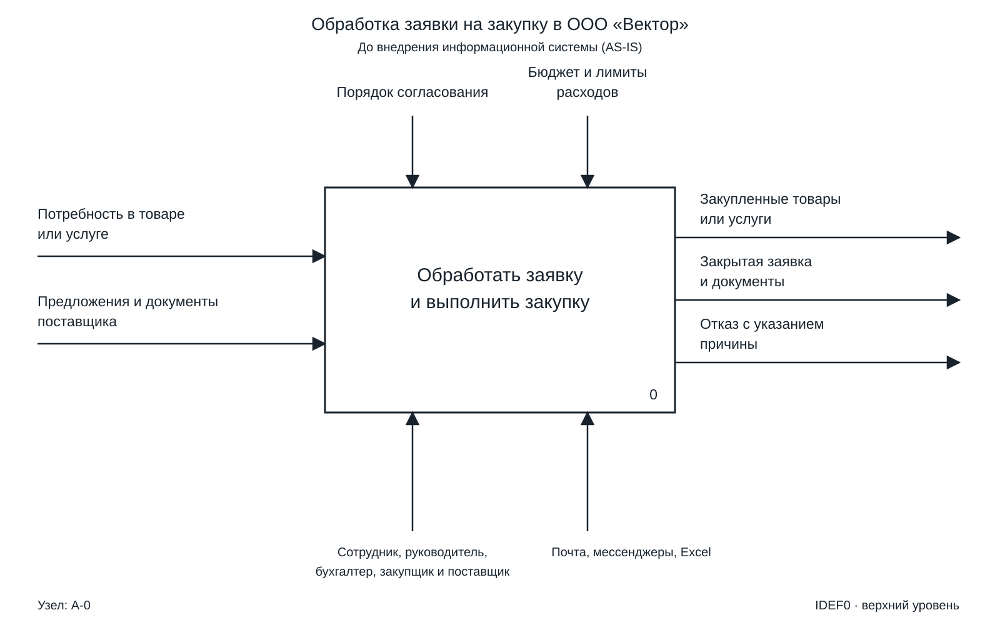
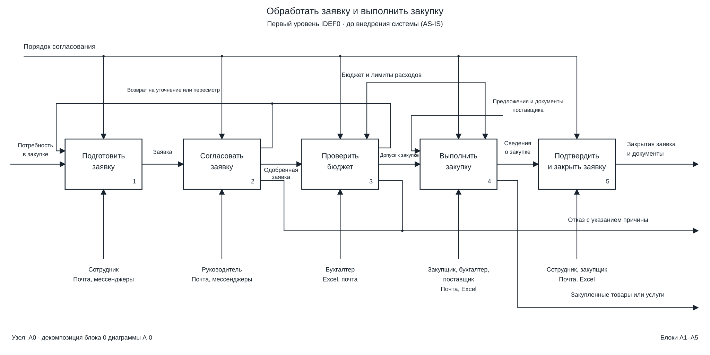
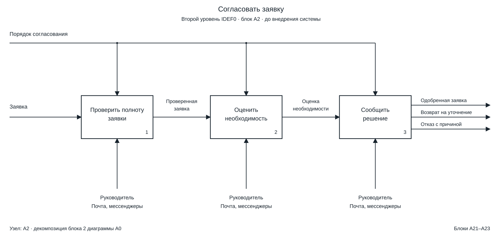
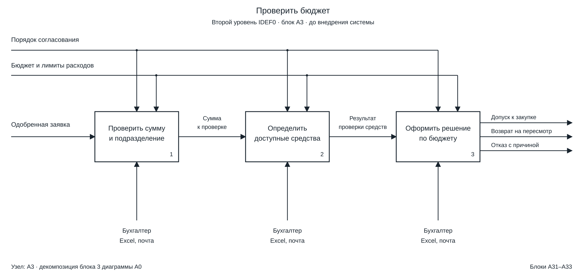
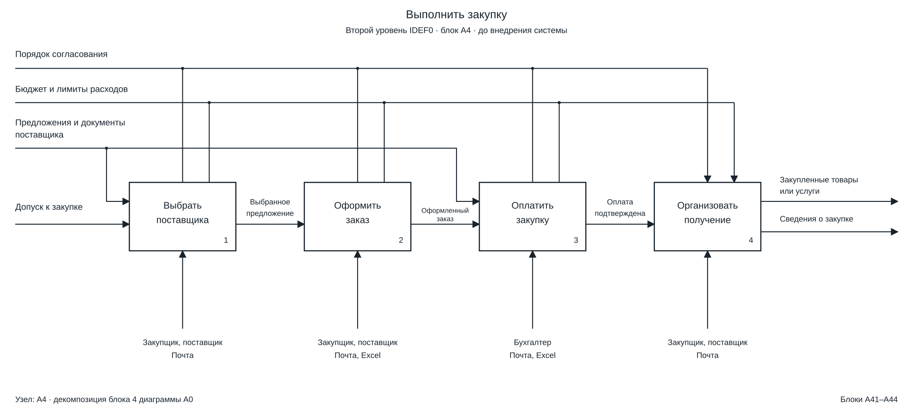
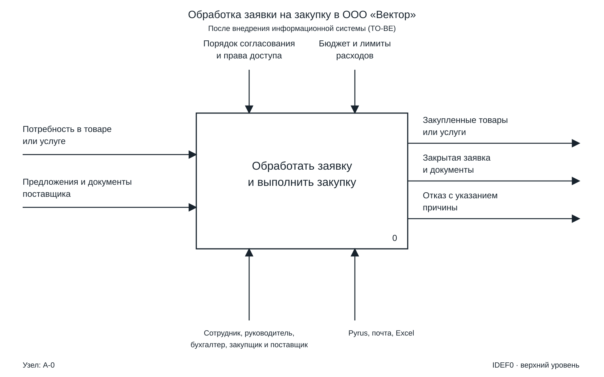
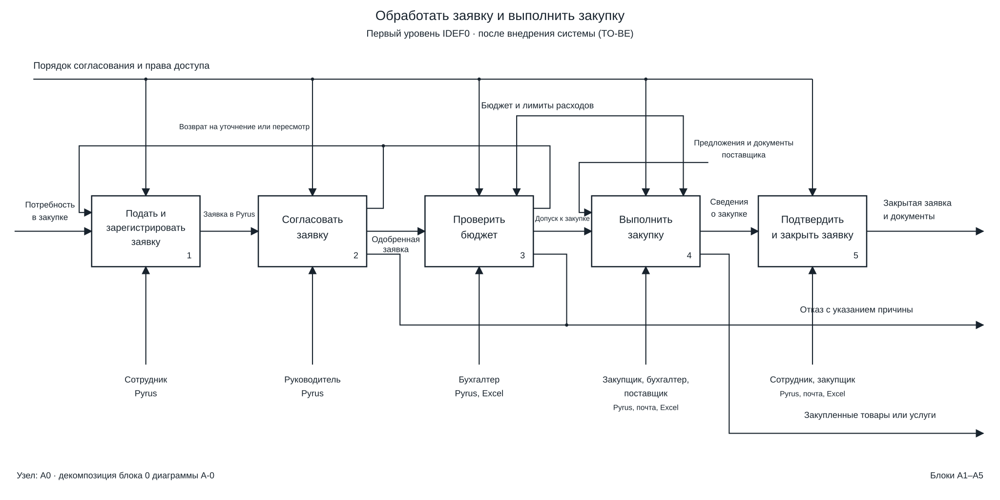
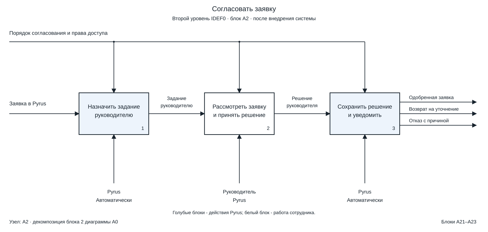
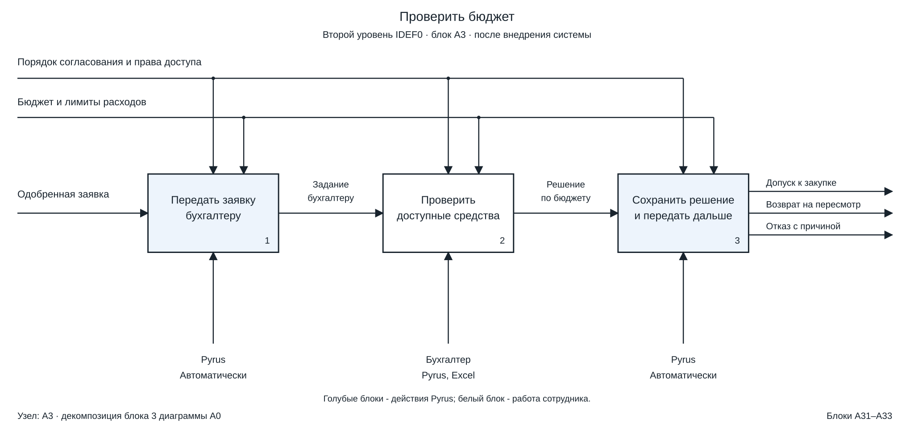
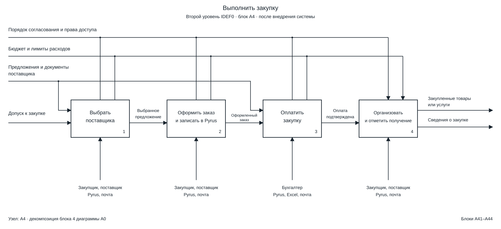

# Модель бизнес-процессов с учетом внедрения информационной системы

**Практическая работа № 3:** «Разработка модели бизнес-процессов с учетом внедрения информационной системы»  
**Тема проекта:** «Управление заявками на закупку и согласованием расходов в небольшой организации»

**Выполнил:** Шитарев Андрей Сергеевич

**Группа:** K3340

**Преподаватель:** Духанов Алексей Валентинович

**Поток:** ПроектИнфСист 1.2

## Введение

**Цель:**

```Описать процессы организации до и после внедрения информационной системы и определить, как изменится работа с заявками на закупку.```

**Контекст:**

```Основой служит концепция из практической работы № 2. Рассматривается ООО «Вектор», которое разрабатывает и сопровождает программы: 80 сотрудников, 5 подразделений и 100 заявок на закупку в месяц. Будущей системой будут пользоваться 40 сотрудников. Это данные придуманные для предыдущей практической работы для оценки характеристик.```

**Выбранное решение для оптимизации:**

```До внедрения заявки передаются по почте и в мессенджерах, а расходы учитываются в Excel. Выбранное решение - настройка Pyrus для подачи заявок, согласования, уведомлений и отслеживания состояния закупки. Решения о покупке, проверка бюджета, оплата и получение остаются за сотрудниками.```

**Задача:**

```Построить верхний уровень обеих моделей, разделить каждый процесс не менее чем на пять блоков первого уровня, подробно раскрыть три блока на втором уровне (задание на 2 дополнительных балла), пояснить диаграммы и сравнить работу до и после внедрения. Для второго уровня допускаются IDEF0 или BPMN.```

## 1. Диаграмма верхнего уровня IDEF0 до внедрения системы

На верхнем уровне весь процесс показан одним блоком «Обработать заявку и выполнить закупку». Диаграмма IDEF0 показывает, что поступает в процесс, чем он регулируется, кто его выполняет и какой результат получается.

В IDEF0 сторона блока определяет смысл стрелки:

- **Слева в блок** входят данные или материалы, которые используются и обрабатываются в процессе.
- **Сверху в блок** входят управления: правила, условия и ограничения, определяющие выполнение работы.
- **Снизу в блок** входят механизмы: люди, оборудование и программы, с помощью которых выполняется работа.
- **Справа из блока** выходят результаты работы: данные, документы, товары или услуги.

Вход показывает, **что обрабатывается**, управление – **по каким правилам**, механизм – **кто и с помощью чего работает**, выход – **что получено**.



[Исходная диаграмма в формате SVG](diagrams/as-is-context.svg).

- **Входы, слева:** потребность в товаре или услуге, предложения и документы поставщика.
- **Управления, сверху:** порядок согласования, бюджет и лимиты расходов. Они определяют, можно ли выполнить закупку.
- **Механизмы, снизу:** сотрудники, поставщик, почта, мессенджеры и Excel. Это участники и средства выполнения работы.
- **Выходы, справа:** закупленные товары или услуги, закрытая заявка с документами либо отказ с указанием причины.

Обработка выполняется вручную с помощью переписки и таблиц. Единой системы для учета и согласования заявок нет.


## 2. Декомпозиция первого уровня IDEF0 до внедрения системы

Разделим общий процесс на пять блоков. Диаграмма A0 раскрывает блок 0 верхнего уровня и показывает, как заявка проходит между участниками.



[Исходная диаграмма в формате SVG](diagrams/as-is-level-1.svg).

- **A1. Подготовить заявку:** сотрудник описывает потребность, сумму и срок закупки.
- **A2. Согласовать заявку:** руководитель проверяет необходимость покупки, одобряет, возвращает на уточнение или отказывает.
- **A3. Проверить бюджет:** бухгалтер проверяет доступные средства с учетом согласованных расходов. При нехватке денег заявка возвращается на пересмотр или отклоняется.
- **A4. Выполнить закупку:** закупщик работает с предложениями и документами поставщика, оформляет заказ, бухгалтер оплачивает.
- **A5. Подтвердить и закрыть заявку:** сотрудник подтверждает получение, закупщик завершает учет в Excel.

Слева между блоками передаются заявка, одобрение, допуск к закупке и сведения о выполнении. Сверху поступают порядок согласования и ограничения бюджета, снизу - участники и рабочие инструменты. Точки обозначают соединение стрелок; пересечения без точки не являются соединениями.

Внешние входы и выходы сохранены с верхнего уровня. Результат - закупленные товары или услуги и закрытая заявка с документами либо отказ с причиной. Возврат на уточнение ведет к подготовке заявки и повторному согласованию. Передача сведений и учет остаются ручными.


## 3. Декомпозиция трех (для дополнительных баллов) блоков второго уровня до внедрения системы

Подробно раскроем три блока первого уровня: A2 «Согласовать заявку», A3 «Проверить бюджет» и A4 «Выполнить закупку». Используется IDEF0. Входы, выходы, управления и механизмы каждого блока сохраняются с диаграммы A0.

### 3.1. Согласование заявки - A2

Руководитель проверяет сведения и необходимость покупки, затем сообщает решение.



[Исходная диаграмма в формате SVG](diagrams/as-is-a2.svg).

Внутренние действия: **A21** - проверить полноту заявки; **A22** - оценить необходимость закупки; **A23** - сообщить одобрение, возврат или отказ. Если сведений недостаточно, в решении указывается, что нужно уточнить.

- **Вход:** заявка от сотрудника.
- **Управление:** порядок согласования.
- **Механизмы:** руководитель, почта и мессенджеры.
- **Выходы:** одобренная заявка для бухгалтера, возврат на уточнение либо отказ с причиной. Возврат направляется в A1, после исправления согласование повторяется.

### 3.2. Проверка бюджета - A3

Бухгалтер определяет, достаточно ли средств для согласованной покупки.



[Исходная диаграмма в формате SVG](diagrams/as-is-a3.svg).

Внутренние действия: **A31** - проверить сумму и подразделение; **A32** - определить доступные средства с учетом уже согласованных расходов; **A33** - записать и передать решение.

- **Вход:** одобренная руководителем заявка.
- **Управления:** порядок согласования, бюджет и лимиты расходов.
- **Механизмы:** бухгалтер, Excel и почта.
- **Выходы:** допуск к закупке, возврат на пересмотр либо отказ с причиной. При возврате сотрудник исправляет заявку в A1, затем она снова проходит руководителя и бухгалтера.

### 3.3. Выполнение закупки - A4

После проверки бюджета закупщик организует заказ и получение, а бухгалтер выполняет оплату.



[Исходная диаграмма в формате SVG](diagrams/as-is-a4.svg).

Внутренние действия: **A41** - выбрать поставщика; **A42** - оформить заказ; **A43** - оплатить закупку по документам; **A44** - организовать получение товара или услуги. Документы поставщика используются при выборе и оплате.

- **Входы:** допуск к закупке, предложения и документы поставщика.
- **Управления:** порядок согласования, бюджет и лимиты расходов.
- **Механизмы:** закупщик, бухгалтер, поставщик, почта и Excel.
- **Выходы:** закупленные товары или услуги и сведения о закупке для A5. Подтверждение сотрудником и закрытие заявки относятся к A5 и здесь не выполняются.

Во всех трех блоках решения и передача документов выполняются сотрудниками вручную. Данные остаются в переписке и таблицах.


## 4. Модель процессов после внедрения системы

Построим те же уровни для работы с Pyrus. Сохраняются пять основных блоков и декомпозиция A2, A3 и A4. Система передает задания, сохраняет решения и уведомляет участников. Решения о покупке, проверка бюджета, оплата и получение остаются за людьми.

### 4.1. Верхний уровень - A-0

Весь процесс показан одним блоком. Его назначение и результаты сохраняются, но к средствам работы добавляется Pyrus.



[Исходная диаграмма в формате SVG](diagrams/to-be-context.svg).

- **Входы:** потребность в товаре или услуге, предложения и документы поставщика.
- **Управления:** порядок согласования, права доступа, бюджет и лимиты расходов.
- **Механизмы:** сотрудники, поставщик, Pyrus, почта и Excel.
- **Выходы:** закупленные товары или услуги, закрытая заявка с документами либо отказ с причиной.

Pyrus объединяет сведения о заявке и ее согласовании. Почта сохраняется для общения с поставщиком, Excel - для проверки бюджета.

### 4.2. Первый уровень - A0

Разделим процесс на пять блоков. Связи между ними сохраняются, но внутренние задания и решения передаются через Pyrus.



[Исходная диаграмма в формате SVG](diagrams/to-be-level-1.svg).

- **A1:** сотрудник заполняет форму, Pyrus проверяет поля и регистрирует заявку.
- **A2:** руководитель принимает решение, система сохраняет его и передает заявку дальше.
- **A3:** бухгалтер проверяет средства и вводит решение в Pyrus.
- **A4:** закупщик организует закупку и записывает сведения, бухгалтер оплачивает.
- **A5:** сотрудник подтверждает получение, закупщик фиксирует завершение, Pyrus закрывает заявку.

Возвраты направляются в A1. После изменения сведений заявка снова проходит согласование. Отказы сохраняются с причиной и сопровождаются уведомлением. Сверху показаны правила, снизу - исполнители и программы; внешние входы и выходы соответствуют верхнему уровню.

### 4.3. Согласование заявки - A2

Проверку выполняет руководитель, а назначение задания и передачу результата - Pyrus.



[Исходная диаграмма в формате SVG](diagrams/to-be-a2.svg).

**A21:** система назначает задание руководителю. **A22:** руководитель рассматривает заявку и принимает решение. **A23:** система сохраняет решение и уведомляет нужного участника.

- **Вход:** заявка в Pyrus.
- **Управления:** порядок согласования и права доступа.
- **Механизмы:** руководитель и Pyrus.
- **Выходы:** одобренная заявка для бухгалтера, возврат в A1 либо отказ с причиной.

Голубые блоки показывают автоматические действия, белый - работу руководителя. Решение не нужно пересылать отдельным письмом.

### 4.4. Проверка бюджета - A3

Pyrus передает заявку бухгалтеру, но не рассчитывает бюджет автоматически.



[Исходная диаграмма в формате SVG](diagrams/to-be-a3.svg).

**A31:** система назначает задание бухгалтеру. **A32:** бухгалтер проверяет сумму и подразделение, сверяет доступные средства в Excel с учетом согласованных расходов. **A33:** Pyrus сохраняет введенное решение и передает заявку дальше.

- **Вход:** одобренная руководителем заявка.
- **Управления:** порядок согласования, права доступа, бюджет и лимиты расходов.
- **Механизмы:** бухгалтер, Pyrus и Excel.
- **Выходы:** допуск к закупке, возврат в A1 на пересмотр либо отказ с причиной.

Голубые блоки выполняются системой. За актуальность бюджета и правильность решения отвечает бухгалтер.

### 4.5. Выполнение закупки - A4

Закупка остается работой сотрудников. Pyrus хранит ее состояние и документы, а не выполняет оплату или поставку.



[Исходная диаграмма в формате SVG](diagrams/to-be-a4.svg).

**A41:** закупщик выбирает поставщика. **A42:** оформляет заказ и записывает сведения в Pyrus. **A43:** бухгалтер оплачивает закупку вне Pyrus и фиксирует результат. **A44:** закупщик организует получение и отмечает его в заявке.

- **Входы:** допуск к закупке, предложения и документы поставщика.
- **Управления:** порядок согласования, права доступа, бюджет и лимиты расходов.
- **Механизмы:** закупщик, бухгалтер, поставщик, Pyrus, почта и Excel.
- **Выходы:** закупленные товары или услуги и сведения для A5. Подтверждение сотрудником и закрытие выполняются в A5.

Участники видят сведения в одной заявке. Переписка с поставщиком остается в почте, необходимые документы прикладываются в Pyrus.

## 5. Различия процессов до и после внедрения системы

Сравним модели AS-IS и TO-BE. Основные этапы закупки сохраняются. Меняются способы передачи заявок, записи решений и контроля выполнения.

| Часть процесса | До внедрения (AS-IS) | После внедрения (TO-BE) |
| --- | --- | --- |
| Подготовка заявки, A1 | Сотрудник составляет заявку и отправляет ее по почте или в мессенджере. | Сотрудник заполняет форму. Pyrus проверяет обязательные поля и регистрирует заявку. |
| Согласование, A2 | Руководитель проверяет заявку и вручную сообщает решение. | Pyrus назначает задание, сохраняет решение руководителя и передает результат. |
| Проверка бюджета, A3 | Бухгалтер проверяет средства в Excel и передает решение по почте. | Проверка остается в Excel. Pyrus назначает задание бухгалтеру, сохраняет его решение и передает заявку дальше. |
| Выполнение закупки, A4 | Сведения о заказе, оплате и получении находятся в переписке и таблицах. | Сотрудники выполняют закупку и фиксируют ее состояние и документы в Pyrus. Оплата проходит вне системы. |
| Закрытие заявки, A5 | Сотрудник подтверждает получение, закупщик завершает учет в Excel. | Подтверждение и завершение фиксируются в Pyrus, после чего система закрывает заявку. |
| Возвраты и отказы | Причины передаются в переписке, сведения приходится искать в отдельных сообщениях. | Причина сохраняется в заявке, участник получает уведомление. После исправления заявка повторно проходит согласование. |
| Контроль состояния | Для проверки состояния нужно обращаться к участникам и сверять переписку с таблицами. | Участники видят состояние и решения в одной заявке с учетом прав доступа. |

В TO-BE автоматизированы регистрация, передача заданий, сохранение решений и уведомления. Это должно сократить ручную переписку и поиск сведений. Решения о покупке, проверка бюджета, оплата и получение остаются за сотрудниками. Результат процесса не меняется: закупка и закрытая заявка с документами либо отказ с причиной.
